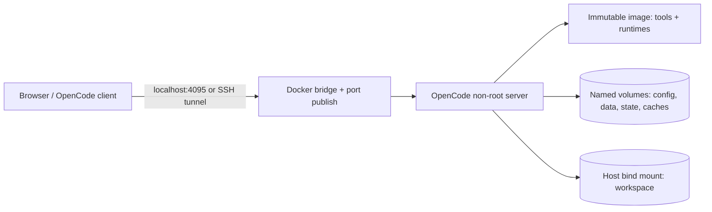

# OpenCode DevKit

**A persistent, modular, Docker-based development environment for [OpenCode](https://opencode.ai).**

[](https://github.com/ahrulsyamil/opencode-devkit/actions/workflows/ci.yml)
[](LICENSE)

OpenCode DevKit packages OpenCode, developer utilities, Node.js/npm/pnpm, and an optional native `agent-browser` + system Chromium into reproducible Docker images. OpenCode's data, configuration, sessions, settings, and your project workspace remain outside the container's writable layer, so image rebuilds and container recreation do not erase them.

> **Security boundary:** OpenCode can run shell commands within the mounted workspace. The default server listens on host loopback only. Do not expose it directly to the internet or mount the Docker socket by default.

## Highlights

- Based on the official `ghcr.io/anomalyco/opencode` image, version configurable (default `2.2.7`).
- Four build targets: `minimal`, `web`, `browser` (default), `full`.
- Core tooling: Git, SSH client, curl/wget, jq/yq, bash, zip/unzip, make/build-base, rg/fd/fzf, editors and diagnostics.
- Node.js, npm, and pinned pnpm in every profile; pinned `agent-browser` + Alpine Chromium in browser/full profiles.
- OpenCode config, data (including v2 SQLite sessions and credentials), state, caches and browser settings in named volumes.
- Developer's source workspace in a configurable host bind mount.
- Non-root runtime user (build-time UID/GID); automatic first-run config seeding.
- Healthcheck, smoke test, persistence test, backup/restore, and GitHub CI/publishing examples.
- Docker CLI optional in the `full` image; the Docker socket is **never** mounted automatically.

## Requirements

- Linux, macOS, or Windows with Docker Engine/Desktop and Docker Compose v2.17+ (supports `up --wait`).
- `git`, GNU Make, Bash, `od`, `sed`, and `tar` for Make-based management scripts.
- Internet connection during the initial build for Alpine packages and npm dependencies.
- 2 GB RAM recommended for `minimal`; 4 GB+ recommended for browser usage. Image sizes and runtime requirements depend on tool selection.
- Supported targets intended: `linux/amd64`, `linux/arm64`. Confirm availability for your chosen Alpine packages and browser at build time.

## Quick start

```bash
git clone https://github.com/ahrulsyamil/opencode-devkit.git
cd opencode-devkit
make init        # creates .env with a unique random password; does not overwrite it
make up          # builds and launches OpenCode
make smoke       # checks core tools and browser tool if installed
```

Open the local server at **http://127.0.0.1:4095**. OpenCode v2 may use browser-based pairing/login depending on its configured UI; use the password stored in your local `.env`. The connection uses HTTP on loopback only.

To connect to a remote VPS without exposing the service:

```bash
ssh -L 4095:127.0.0.1:4095 ubuntu@YOUR_VPS_IP
# then open http://127.0.0.1:4095 locally
```

For a legacy VPS workspace change `.env`:

```dotenv
WORKSPACE_DIR=/home/ubuntu/projects
```

Make sure the host directory exists and is writable by the container's `DEV_UID:DEV_GID`.

### Select a profile

In `.env`:

```dotenv
DEVKIT_PROFILE=minimal  # small: core + Node + pnpm
# DEVKIT_PROFILE=web     # add Python/uv and database CLIs
# DEVKIT_PROFILE=browser # default: agent-browser + Chromium
# DEVKIT_PROFILE=full    # browser + Go, Rust, Java, gh, Docker CLI, DB clients
```

Then rebuild and recreate:

```bash
make up
```

Profiles are Docker **build targets**, not runtime package installs. Installing tools manually with `apk` or `npm -g` inside a running container is ephemeral, by design.

## Essential commands

| Goal | Command |
| --- | --- |
| Initialize local secrets and workspace | `make init` |
| Build image with current profile | `make build` |
| Start/update service | `make up` |
| Stop service | `make stop` |
| Remove service while keeping volumes | `make down` |
| Force recreate container | `make recreate` |
| Open shell | `make shell` |
| Tail logs | `make logs` |
| Validate config/setup | `make doctor` |
| Test installed tools | `make smoke` |
| Prove persistence across force recreate | `make test-persistence` |
| Back up named volumes (stops service) | `make backup` |
| Restore backup (interactive; stops service) | `make restore FILE=backups/devkit-...tar.gz` |
| Upgrade OpenCode image | `make update-opencode VERSION=x.y.z` |
| Upgrade pinned npm tooling | `make update-tools PNPM=x.y.z AGENT_BROWSER=x.y.z` |
| Clear selected npm/pnpm caches | `make clean-cache` |

`make down` preserves volumes. **Do not use `docker compose down -v` or delete the workspace directory** unless you intentionally want to remove data.

## Persistence at a glance

| Data | Location inside container | Type |
| --- | --- | --- |
| OpenCode config, GH CLI settings, Git config | `/home/devkit/.config` | `devkit-config` volume, or bind via `DEVKIT_CONFIG_SOURCE` |
| OpenCode SQLite DB, sessions/credentials, pnpm home | `/home/devkit/.local/share` | `devkit-data` volume |
| OpenCode logs/state | `/home/devkit/.local/state` | `devkit-state` volume |
| Build/package caches | `/home/devkit/.cache` | `devkit-cache` volume |
| npm cache | `/home/devkit/.npm` | `devkit-npm` volume |
| agent-browser settings and profile data | `/home/devkit/.agent-browser` | `devkit-browser` volume |
| Source code and git repositories | `/workspace` | `WORKSPACE_DIR` bind mount |
| Binaries and OS packages | image filesystem | Dockerfile build stages |

On the first start, `config/opencode.json` seeds the persistent user config at `~/.config/opencode/opencode.json` **only if missing**. Edit it in the container, for example `make shell` then `nano ~/.config/opencode/opencode.json`. Later updates do not overwrite edits.

The database may hold provider API tokens; keep backups confidential. The `make backup` command includes named volumes but **not** the workspace or `.env`; back those up separately.

## Architecture



The default network is Docker bridge. The host port is bound to `127.0.0.1` even though the process must listen on `0.0.0.0` **inside** the container. To use a public domain, deploy a correctly configured HTTPS reverse proxy with authentication and access restrictions; see [Security](docs/SECURITY.md).

## Configuration

See [Configuration reference](docs/CONFIGURATION.md) for all `.env` keys, runtime permissions, and the seeded `opencode.json` file. Use the pinned `OPENCODE_VERSION` to update only after verifying upstream changes. Current versions of OpenCode may accept `OPENCODE_PASSWORD` for server authentication; this project uses that supported server variable.

The default image is intentionally leaner than `full`. See [Profiles](docs/PROFILES.md) and [Extending](docs/EXTENDING.md) for additional system packages and custom Dockerfiles.

## Documentation

- [Architecture and persistence](docs/ARCHITECTURE.md)
- [Profiles and tool matrix](docs/PROFILES.md)
- [Configuration reference](docs/CONFIGURATION.md)
- [Security and threat model](docs/SECURITY.md)
- [Upgrades and release management](docs/UPGRADING.md)
- [Troubleshooting](docs/TROUBLESHOOTING.md)
- [Adding custom tools](docs/EXTENDING.md)
- [Backups and restore](docs/BACKUP.md)
- [Contributing](CONTRIBUTING.md)
- [Vulnerability reporting](SECURITY.md)

## Tests and CI

```bash
make verify                  # standard library static integrity tests (Python 3)
bash -n scripts/*.sh         # shell syntax
make doctor                  # requires Docker
make smoke                   # requires running container
make test-persistence        # actually recreates the running container
```

GitHub Actions validates shell/Compose/Dockerfiles, builds the image, and runs core smoke tests. A separate publish workflow on version tags prepares GHCR publishing. Multi-arch support, browser launch success, and vulnerabilities must be verified in the CI workflow for each release; they are **not** established merely by these local files.

## Publishing to your GitHub account

Maintainers can publish a freshly extracted project folder by installing GitHub CLI (`gh`), authenticating as `ahrulsyamil` with `gh auth login`, and running:

```bash
# Configure your Git identity first, if needed:
# git config --global user.name "Your Name"
# git config --global user.email "you@example.com"
bash scripts/publish-github.sh
```

The script verifies the active account, refuses to overwrite an existing repository/remote, shows staged files, and asks for an explicit confirmation before it creates the **public** `ahrulsyamil/opencode-devkit` repository and pushes `main`. It does not publish anything automatically.

## License and attribution

MIT License. This is an independent community project, not an official OpenCode distribution. OpenCode is developed by [Anomaly](https://github.com/anomalyco/opencode) and agent-browser by [Vercel Labs](https://github.com/vercel-labs/agent-browser); follow upstream license and release notes.
